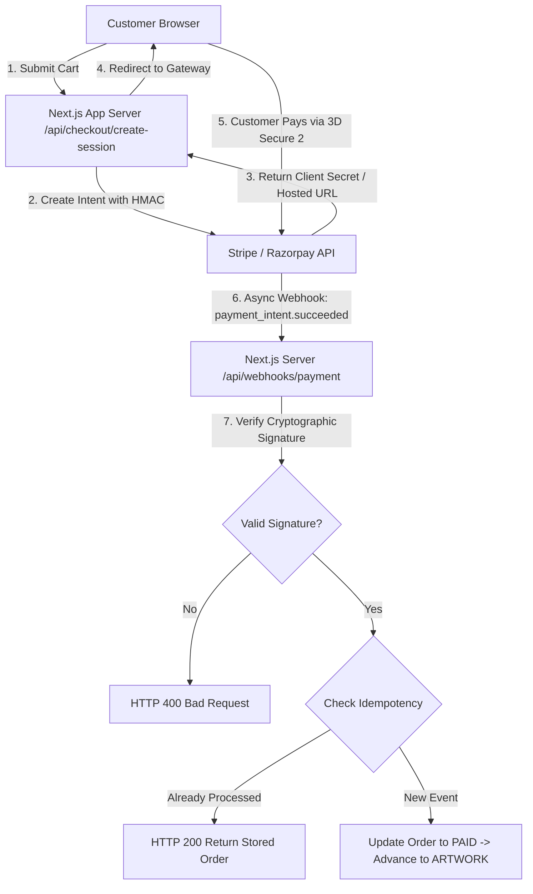
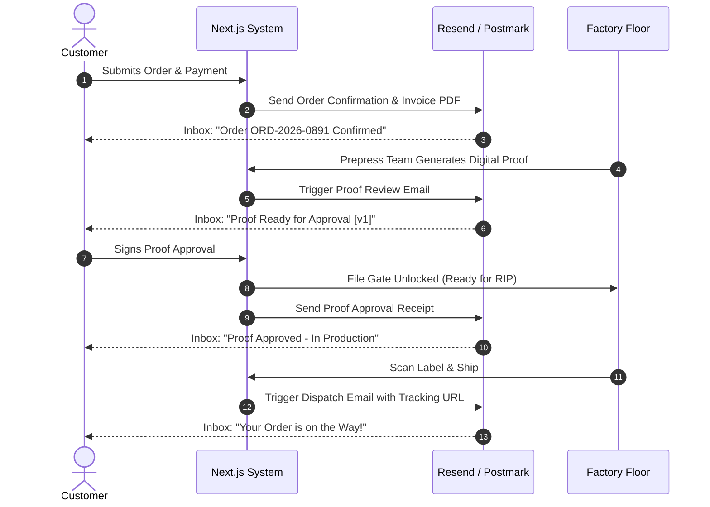
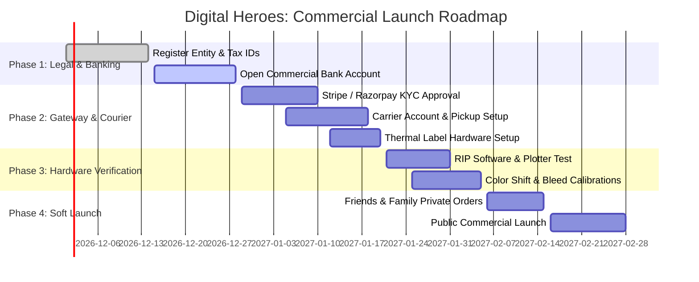

# DIGITAL HEROES — COMMERCIAL LAUNCH READINESS PLAN
**Document ID:** `DH-LAUNCH-READINESS-2026-V1`  
**Application Release Baseline:** `digital-heroes-demo-v1.0` (Git Commit `1d0c4fd`)  
**Operating Mode:** Demo / Simulated Mock Mode (Zero-Credential Dependency)  
**Target Goal:** Step-by-step roadmap from local demo freeze to live commercial operations  

---

## EXECUTIVE SUMMARY & STATUS DEFINITION

The **Digital Heroes Demo v1.0** application is fully functional in development and demonstration mode:
- **12 Automated Test Suites Passed** (399 assertions passed, 0 failed).
- **TypeScript Typecheck Clean** (`tsc --noEmit` exited code 0).
- **Verified Working Workflows:** All six product configurators, dynamic matrix pricing with UK 20% VAT, in-browser vector artwork preflight, proofing engine with SHA-256 cryptographic approval gate, simulated payment checkout, factory Kanban pipeline with machine allocation, 300 DPI print master generator with binary FOGRA39 ICC embedding, simulated courier label printing (Royal Mail & DPD), and simulated Xero accounting synchronization.

**Current Operational Reality:**
The application is currently operating in **Mock / Simulated Mode**. The business does not yet possess:
1. A formally registered business entity.
2. A commercial business bank account.
3. An active live merchant account (Stripe, Razorpay, or Cashfree).
4. Direct commercial courier contracts (Royal Mail, DPD, Shiprocket, or Delhivery).
5. A live transactional email sending domain with authenticated SPF/DKIM/DMARC records.
6. Calibrated industrial RIP software and wide-format cutting hardware integration.

This document serves as the operational master plan to bridge the gap between Demo v1.0 and a compliant, profitable, and secure commercial launch.

---

## STAGE A — DEMONSTRATION READINESS (DEMO v1.0 AUDIT)

The demo application is structured to allow pitch presentations, investor demonstrations, and user testing without incurring external operational costs or risking unhandled network crashes.

| Requirement | Audit Status | Evidence / Verification Method |
| :--- | :---: | :--- |
| **Application Launch** | **YES** | Starts cleanly on Node.js / Next.js Turbopack (`http://localhost:3000`). Responds within 1.2s. |
| **Customer Journey** | **YES** | Home -> Division Selection -> Configurator -> Vector Designer -> Cart -> Simulated Checkout -> Dashboard. |
| **Admin Floor Journey** | **YES** | Admin Login -> Kanban Pipeline -> Machine Allocation -> Proof Inspection -> Master Download -> Dispatch. |
| **6 Manufacturing Divisions** | **YES** | Custom Roll Labels, Race Numbers & Bibs, MTB Handlebar Boards, Custom Rubber Stamps, Cast Medals & Acrylic Trophies, Laser Cut & Engraved Signage. |
| **Dynamic Pricing Engine** | **YES** | Multi-tier area-based base rates, material multipliers, finishing add-ons, quantity volume breaks, and 20% UK VAT. |
| **Artwork Preflight** | **YES** | 300 DPI density validation, CMYK/RGB gamut warning, 3 mm bleed margin check, embedded fonts and cut contour detection. |
| **Proofing & Gate** | **YES** | Revision incrementation (v1 -> v2), customer feedback capture, SHA-256 approval hash, and cryptographic lock preventing unapproved production downloads. |
| **Order Creation** | **YES** | Atomic client/server order persistence, distinct sequential order numbers (`ORD-2026-XXXX`), itemized breakdown. |
| **Production Masters** | **YES** | Standalone 300 DPI high-resolution master PNG generation (`pHYs` 11,811 px/m) with `#FF00FF` Spot Cut Contour, binary ISO 15076-1 FOGRA39 ICC profile embedding, and 4x6" PDF shipping labels. |
| **Responsive Viewports** | **YES** | Mobile (390px iPhone), Small Tablet (768px iPad Mini), Large Tablet (1024px iPad Pro), Desktop (1440px). Touch targets &ge; 44px. |
| **Application Health** | **YES** | Zero uncaught exceptions, zero console errors, graceful fallback handlers for all simulated services. |
| **Demo Data Isolation** | **YES** | Seed accounts provided (`customer@digitalheroes.demo`, `customer-b@digitalheroes.demo`, `admin@digitalheroes.demo`). All mock data clearly watermarked as simulated. |

---

## STAGE B — BUSINESS & LEGAL PREPARATION

Before accepting a single live customer transaction, legal and financial structures must be formally established to ensure compliance with taxation laws and commercial liability.

### 1. Business Entity Formation
Choose the structure that matches your primary operational jurisdiction:

#### Option 1: United Kingdom (Current App Seed Configuration)
- **Sole Trader:** Simplest to launch. Register with HMRC for Self Assessment. You are personally liable for business liabilities.
- **Private Limited Company (Ltd):** Recommended for custom manufacturing due to physical equipment and product liability risks. Register via Companies House (~£50). Protects personal assets.
- **Corporate Bank Account:** Open a UK business bank account (e.g., Tide, Monzo Business, Starling, or Barclays). Requires Certificate of Incorporation and Proof of Address.
- **VAT Registration:** Compulsory if taxable turnover exceeds £90,000 in a rolling 12-month period. Voluntary registration is recommended earlier if purchasing commercial capital equipment (to reclaim 20% VAT on raw media and printers).

#### Option 2: India
- **Sole Proprietorship:** Low setup barrier; requires registering an MSME Udyam Certificate and opening a Current Bank Account using GST registration.
- **Limited Liability Partnership (LLP) or Private Limited (Pvt Ltd):** Recommended if onboarding partners or seeking seed capital. Incorporated via the Ministry of Corporate Affairs (MCA) through SPICe+ form.
- **Tax Identifiers:**
  - **Permanent Account Number (PAN):** Business entity PAN card.
  - **Goods and Services Tax (GST):** Mandatory for e-commerce operators selling goods interstate or exceeding ₹40 Lakhs turnover (₹20 Lakhs for services).
- **Current Account:** Open an Indian Current Account (e.g., ICICI, HDFC, RazorpayX) enabled for payment gateway settlement.

### 2. Mandatory Commercial Policies & Customer Disclaimers
Custom manufacturing platforms require specialized legal terms to prevent customer disputes regarding artwork, color variance, and delivery delays:

1. **Terms of Service:**
   - IP Ownership: Customer warrants they own or hold licenses for all logos/trademarks uploaded. Digital Heroes is indemnified against copyright infringement.
   - Proof Approval Finality: Explicit clause stating that **customer sign-off on a digital proof constitutes irrevocable approval** of artwork geometry, spelling, and copy. Corrections requested after proof approval incur reprints at customer expense.
2. **Refund & Cancellation Policy:**
   - Standard consumer cooling-off periods (e.g., UK Consumer Contracts Regulations 14-day right to cancel) **do not apply to custom bespoke goods** made to the customer's exact specification once production has commenced.
   - Refunds permitted solely for material manufacturing defects or deviations exceeding documented engineering tolerances.
3. **Print & Color Shift Disclaimers:**
   - **Color Shift:** RGB screen displays transmit light; CMYK presses subtract light. Proofs on monitors are sRGB approximations. Variations between RGB monitors and CMYK industrial prints (Delta E &le; 3.0) are acceptable industry standard.
   - **Mechanical Tolerances:** Cutting plotter registration tolerance is &plusmn;1.0 mm. Designs without 3 mm bleed or elements placed inside the 2 mm safety margin may be subject to clipping.
4. **Shipping & Transit Policy:**
   - Production lead times (e.g., 2–4 business days) are separate from transit carrier timelines.
   - Lost-in-transit claims subject to carrier investigation window (e.g., 10 working days for Royal Mail).

---

## STAGE C — REAL PAYMENT GATEWAY INTEGRATION

The current checkout at `/checkout` utilizes `lib/orders/order-store.ts` in simulated mode. Transitioning to real card processing requires an authorized merchant gateway.



### 1. Gateway Options & KYC Requirements
- **Stripe (UK / Global):** Standard choice. Requires business bank IBAN, registered company number, director passport/ID, and live website with refund policies visible.
- **Razorpay / Cashfree (India):** Best for UPI, NetBanking, and RuPay cards. Requires GSTIN, Company PAN, Board Resolution/Partnership Deed, and bank statement.

### 2. Migration Architecture: Replacing Simulated Checkout
To transition safely without breaking existing demo capabilities:
1. **Environment Flag:** Implement `PAYMENT_MODE=simulated` or `PAYMENT_MODE=live`.
2. **Server-Authoritative Pricing:** The payment session amount **must** be recomputed on the server from the product configuration in `lib/pricing/engine.ts`. Never trust client-submitted total amounts.
3. **Webhook Signature Verification:** Use raw request body buffer with `stripe.webhooks.constructEvent()` or `crypto.createHmac('sha256', secret)` to reject spoofed payment events.
4. **Idempotency Guarantee:** Store webhook event IDs (`evt_xxxx`) in an `idempotency_keys` table. If a duplicate event arrives from Stripe/Razorpay retries, return HTTP 200 without creating duplicate orders or double-crediting balances.
5. **Customer Cancellation & 3DS Failures:** Provide clean return URLs (`/checkout/cancelled`) that preserve the customer's cart so they can reattempt without re-uploading artwork.

---

## STAGE D — REAL COURIER INTEGRATION & DISPATCH AUTOMATION

Currently, `lib/shipping/carrier-adapter.ts` operates in `SIMULATED_FALLBACK` mode, generating compliant 4x6" PDF mock labels.

### 1. Carrier Infrastructure Matrix

| Jurisdiction | Preferred Provider | Integration Type | Label Format | Requirements |
| :--- | :--- | :--- | :--- | :--- |
| **UK Domestic** | **Royal Mail Click & Drop** | REST API v1 (`/api/v1/orders`) | 4x6" PDF (ZPL / PDF) | Online Business Account (OBA), minimum annual parcel volume. |
| **UK Express** | **DPD UK** | DeliTrack SOAP / REST API | 4x6" EPL/ZPL/PDF | Commercial account, depot collection agreement. |
| **India Multi-Carrier** | **Shiprocket** | REST API (`/v1/external/orders/create`) | 4x6" Thermal A6 | Commercial KYC, prepaid shipping wallet, daily courier pickup. |
| **India Surface/Express**| **Delhivery Direct** | Unified Logistics Interface (B2C API) | 4x6" PDF / Barcode | Signed service agreement, automated manifesting. |

### 2. Hardware: 4x6" Thermal Label Printing
- **Supported Industrial Printers:** Zebra ZD421, TSC DA210, Rollo Commercial Thermal.
- **Resolution:** 203 DPI (8 dots/mm) or 300 DPI (12 dots/mm).
- **Label Substrate:** Direct thermal top-coated paper (water-resistant, smudge-proof) 100mm &times; 150mm (4" &times; 6").
- **Integration Step:** Feed the Base64 PDF directly to the thermal printer via raw CUPS (Linux/macOS) or Windows Spooler API without browser print dialog scaling.

### 3. Dispatch & Tracking Automation Flow
1. **Floor Operator Action:** In `/admin/production`, the operator clicks **"Create Label & Mark Dispatched"**.
2. **API Call:** Next.js sends consignment payload with parcel weight, dimensions, and customer delivery address to Royal Mail or Shiprocket.
3. **Label Response:** The carrier API returns a real consignment barcode and tracking number (e.g., `RM48-98218492GB`).
4. **Order Update:** Order status transitions to `DISPATCHED` (`stage: COMPLETED`).
5. **Customer Tracking:** Customer dashboard displays live carrier tracking link; automated tracking email is dispatched with the tracking URL.

---

## STAGE E — TRANSACTIONAL EMAIL INFRASTRUCTURE

The application currently routes emails through an internal sandbox outbox (`lib/email/email-engine.ts`) viewable on the admin screen.

### 1. Production Provider Selection
- **Resend:** Modern developer-focused API, built on AWS SES infrastructure, native React-email support.
- **Postmark:** Gold standard for transactional delivery speeds and spam-free IP pools.
- **Amazon SES:** Lowest cost at scale ($0.10 per 1,000 emails), but requires manual warm-up and reputation management.

### 2. DNS Authentication Records (Domain Verification)
Before live sending, the domain DNS (e.g., Cloudflare, Route53, Namecheap) must publish:

```dns
; 1. Sender Policy Framework (SPF)
@   IN TXT   "v=spf1 include:amazonses.com include:_spf.resend.com ~all"

; 2. DomainKeys Identified Mail (DKIM) - Example 2048-bit selector
resend._domainkey.digitalheroes.co.uk.   IN CNAME   resend._domainkey.resend-dns.com.

; 3. Domain-based Message Authentication, Reporting & Conformance (DMARC)
_dmarc.digitalheroes.co.uk.   IN TXT   "v=DMARC1; p=quarantine; rua=mailto:dmarc-reports@digitalheroes.co.uk; pct=100; aspf=r;"
```

### 3. Customer Transactional Lifecycle Triggers



---

## STAGE F — FACTORY & HARDWARE PRINT VERIFICATION

The print engine in `lib/print-engine/generator.ts` outputs 300 DPI high-resolution masters with embedded ISO 15076-1 FOGRA39 ICC profiles and vector cut contours. Physical production verification is required before commercial volume runs.

### 1. Prepress File Structure Verification
- **Output Validation:** Verify the generated PDF/X-1a or high-res PNG master in Adobe Acrobat Pro Preflight or Enfocus PitStop.
- **Resolution:** Confirm strict 11,811 pixels per meter (300.0 DPI) density (`pHYs` chunk).
- **Bleed & Safety:** Verify full 3.0 mm exterior bleed expansion beyond trim dimensions.
- **Color Space:** Confirm CMYK color primaries with embedded ICC device profile. RGB images must be transformed to FOGRA39 using perceptual or relative colorimetric rendering intents.

### 2. RIP Software Ingestion Tests
Ingest the generated production masters into commercial Raster Image Processors:
- **Caldera RIP:** Test Spot Color replacement for `#FF00FF` mapping to `CutContour` or `KissCut`.
- **Onyx Graphics (Thrive / PosterShop):** Test Quick Sets for contour cut extraction and color profile override.
- **Roland VersaWorks:** Test dual-layer print & cut alignment on TrueVIS or VersaSTUDIO systems.

### 3. Digital Finishing & Cutting Plotter Verification
- **Zünd Cut Center (ZCC):** Ingest vector PDF cut layers. Verify separation of `ThruCut` (perimeter through-cut) vs. `KissCut` (sticker peel liner preservation).
- **Summa GoProduce / Graphtec Cutting Master:** Verify optical registration marks (OPOS) can be read by the sensor camera across heavy holographic and metallic laminates without glare distortion.
- **Mechanical Tolerances:** Calibrate blade depth and tool pressure to ensure zero liner penetration on self-adhesive vinyl rolls.

---

## STAGE G — PRODUCTION HOSTING & SECURITY INFRASTRUCTURE

| Layer | Recommended Production Solution | Purpose |
| :--- | :--- | :--- |
| **Frontend & API Hosting** | **Vercel Pro** or **AWS ECS Fargate** | Edge delivery, automated SSL/TLS termination, instant scale. |
| **Database** | **Supabase Managed Postgres (Pro Tier)** | Automated point-in-time recovery (PITR), daily automated backups, dedicated compute. |
| **Storage Buckets** | **Supabase Storage (S3-compatible)** | Private encrypted buckets for customer artwork and production masters with pre-signed URLs. |
| **WAF & DDoS Protection** | **Cloudflare Pro** | Managed Web Application Firewall, bot blocking, HTTP/3, and edge rate limiting. |
| **Application Monitoring** | **Sentry (SaaS)** | Real-time crash telemetry, frontend unhandled promise tracking, API performance monitoring. |
| **Audit Logs** | **PostgreSQL Audit Extension (`pgAudit`)** | Append-only ledger recording all staff accesses to customer files and billing data. |

---

## STAGE H — FINAL LAUNCH CHECKLIST & COMMERCIAL BUDGET

### 1. Go / No-Go Launch Decision Gate

```
[ ] 1. BUSINESS ENTITY: Formal registration completed (Ltd / LLP / Sole Prop) with commercial bank account active.
[ ] 2. TAX & COMPLIANCE: Valid VAT Number (UK) or GSTIN (India) configured on invoice templates.
[ ] 3. LEGAL POLICIES: Terms of Service, Refund Policy, Privacy Policy, and Proof Approval Disclaimers published live.
[ ] 4. PAYMENT GATEWAY: Stripe / Razorpay verified with Live API Keys, Webhook signatures active, and test live transaction refunded.
[ ] 5. COURIER LOGISTICS: Commercial carrier account active, thermal 4x6" label printer calibrated, daily pickup arranged.
[ ] 6. EMAIL DELIVERABILITY: Custom sending domain authenticated with 100% passing SPF, DKIM, and DMARC checks.
[ ] 7. RIP HARNESS: Test PDF printed and precision-cut on physical hardware with zero registration drift (&plusmn;0.5mm).
[ ] 8. BACKUPS & AUDITING: Automated daily database snapshots verified with successful test restore drill.
```

### 2. Estimated Operational Launch Budget (Initial 1–3 Months)

| Line Item | Estimated Cost (UK / Global) | Estimated Cost (India) | Notes |
| :--- | :--- | :--- | :--- |
| **Entity Incorporation & Legal** | £50 – £250 | ₹5,000 – ₹15,000 | Companies House or MCA registration + legal policy templates |
| **Web & App Hosting (Vercel + Supabase)**| £40 / month ($50) | ₹3,500 / month | Pro tier hosting with SSL and managed database backups |
| **Domain & Email Service (Resend/Google Workspace)** | £15 / month | ₹1,200 / month | Business email seats + 50,000 transactional emails/month |
| **Payment Gateway Transaction Fees** | 1.4% + 20p per UK card | 2.0% per domestic transaction | Pay-as-you-go per successful customer order |
| **Thermal Shipping Printer (Hardware)** | £150 – £250 (one-time) | ₹12,000 – ₹18,000 (one-time) | 4x6" Direct Thermal Barcode Printer (Zebra / TSC) |
| **Direct Thermal Shipping Labels (Consumables)** | £15 per 1,000 labels | ₹800 per 1,000 labels | 100mm &times; 150mm roll labels |
| **Initial Working Capital for Raw Stock** | £500 – £2,000 | ₹40,000 – ₹150,000 | Vinyl rolls, laminates, inks, packaging boxes, and tape |

### 3. Recommended Phased Rollout Timeline



---
*End of Commercial Launch Readiness Plan.*

