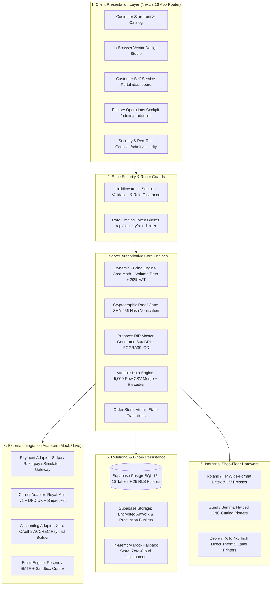
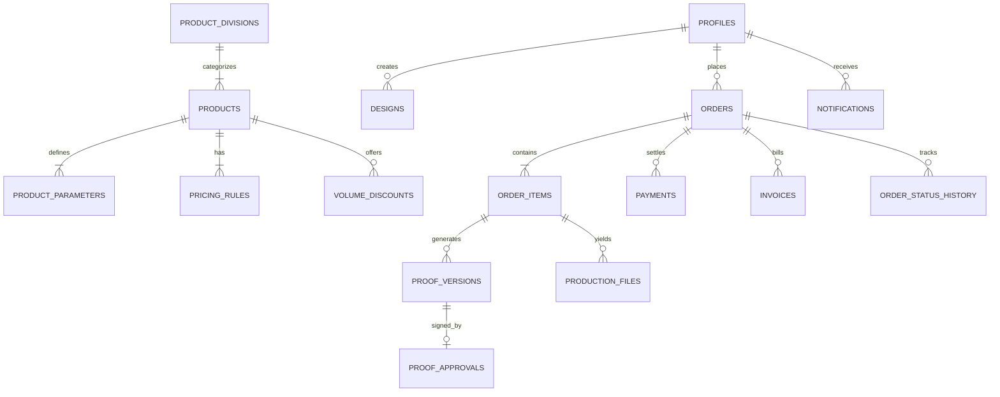
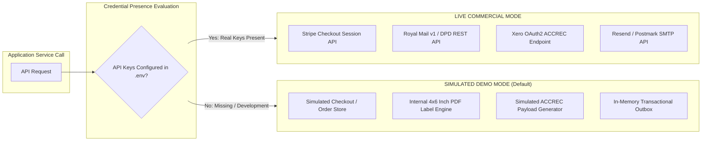

# DIGITAL HEROES — TECHNICAL REQUIREMENTS DOCUMENT (TRD)
**Document Reference:** `DH-TRD-2026-V1.0`  
**System Name:** Digital Heroes Commercial Web-to-Print (W2P) & Factory Floor Execution System  
**Baseline Version:** Release Demo v1.0 (Git Tag `digital-heroes-demo-v1.0`, Commit `1d0c4fd`)  
**Document Classification:** Technical Architecture & System Engineering Specification  
**Author:** Digital Heroes Engineering & Prepress Architecture Team  

---

## 1. DOCUMENT OVERVIEW & ARCHITECTURAL SCOPE

### 1.1 Purpose
This Technical Requirements Document (TRD) provides the authoritative, end-to-end technical engineering specification for the **Digital Heroes** Web-to-Print (W2P) e-commerce and factory manufacturing execution platform. It specifies the system architecture, mathematical engines, data models, API endpoints, prepress graphics pipelines, security controls, and hardware integration adapters.

### 1.2 System Mission
Traditional commercial print platforms suffer from catastrophic "SKU bloat"—requiring separate e-commerce inventory items for every permutation of dimensions, materials, finishes, and quantities. Digital Heroes replaces static SKU catalogs with a **Single Parametric Product Model**, where:
1. Prices are computed in real time down to the millimeter based on surface area math, substrate mass, and volume discount curves.
2. In-browser vector design tools enforce industrial prepress boundaries (3mm bleed, cut lines, safe margins).
3. Production print files remain cryptographically locked on the server until the customer signs an immutable proof.
4. RIP-ready 300 DPI print masters with embedded ISO 15076-1 / FOGRA39 ICC color profiles and vector `#FF00FF` cut contours are generated server-side.
5. All external dependencies (Stripe payments, Royal Mail / DPD shipping, Xero accounting, and Resend email) operate with zero-credential mock/simulated fallbacks while remaining 100% architecturally wired for live commercial activation.

---

## 2. HIGH-LEVEL SYSTEM TOPOLOGY



---

## 3. TECHNOLOGY STACK & RUNTIME SPECIFICATION

| Component | Technology | Version | Purpose & Architectural Justification |
| :--- | :--- | :--- | :--- |
| **Framework** | Next.js (App Router, Turbopack) | `16.4.6` | React Server Components, server actions, route handlers, optimized streaming. |
| **UI Runtime** | React | `19.3.0` | Concurrent rendering, modern hooks, zero client bundle bloat. |
| **Type System** | TypeScript | `^5.0.0` | Strict type safety across all pricing, order, and graphics payloads. |
| **CSS & Design** | Tailwind CSS v4 | `^4.0.0` | Boutique-industrial theme with high-contrast safety accents; compiled via `scripts/build-css.mjs`. |
| **Database** | PostgreSQL on Supabase | `15.x` | Relational data persistence, Row Level Security (RLS), ACID transactions. |
| **Auth** | Supabase Auth + JWT Cookies | `2.49.1` | Multi-role authentication (Admin vs. Customer) synchronized via `dh_role` cookies. |
| **Icons** | Custom SVG Design System | Internal | High-performance inline SVG icons without heavy third-party icon packages. |
| **PDF Generation** | Native Binary PDF Engine | Internal | RFC-compliant `%PDF-1.4` binary generator for invoices, thermal labels, and print masters. |
| **Color Engine** | ISO 15076-1 Binary ICC Injector | Internal | 128-byte header ICC profile (`acsp`, `CMYK`, D50) embedded in PDF and PNG chunks. |
| **Testing** | Node.js Test Harness | `>=20.10.0` | Native ESM test runners (`--experimental-strip-types`) with 12 suites (399 assertions). |

---

## 4. THE 6 MANUFACTURING DIVISIONS & PARAMETRIC MODELS

The application supports six distinct industrial print disciplines. Each division is governed by specific dimensional boundaries, material substrates, and finishing parameters:

```
┌─────────────────────────────────────────────────────────────────────────────────────────────┐
│                             THE 6 MANUFACTURING DIVISIONS                                   │
└─────────────────────────────────────────────────────────────────────────────────────────────┘
  1. LABELS & STICKERS           2. RACE NUMBERS & BIBS        3. MTB HANDLEBAR BOARDS
  • Roll Labels & Sheet Decals   • Waterproof Event Numbers    • Downhill & Enduro Plates
  • Gloss, Matte, Holographic    • Tearproof Tyvek 100/120gsm  • 0.8mm & 1.2mm Polypropylene
  • Kiss-Cut & Die-Cut           • 4-Hole Corner Punching      • Cable-Tie Mounting Slots
  ───────────────────────────────────────────────────────────────────────────────────────────
  4. CUSTOM RUBBER STAMPS        5. TROPHIES & MEDALS          6. LASER-CUT & SIGNAGE
  • Self-Inking & Wooden Mount   • Cast Medals & Acrylic Glass • Plywood, Acrylic & Metal
  • Laser-Vulcanized Rubber      • 10mm Cast PMMA Awards       • Vector Kerf Profiling
  • Replaceable Ink Cartridges   • Solid Hardwood Bases        • Architectural Signage
```

### Division Parameters Matrix

| Division Slug | Minimum Size (mm) | Maximum Size (mm) | Substrates | Finishing Options | Cutting Styles |
| :--- | :--- | :--- | :--- | :--- | :--- |
| `labels` | 25 &times; 25 | 1200 &times; 3000 | White Vinyl, Clear PP, Holographic, Silver Foil | Gloss Laminate, Matte Laminate, Soft-Touch | Kiss-Cut, Die-Cut Thru, Guillotine |
| `race-numbers` | 100 &times; 100 | 250 &times; 350 | Tyvek 100gsm, Synthetic Polymer, Polyart | 4-Corner Punch, Brass Eyelets, Barcode Strip | Rectangular Trim, Rounded Corners |
| `mtb-boards` | 120 &times; 100 | 280 &times; 220 | 0.8mm Polypropylene, 1.2mm High-Impact Poly | Anti-Scratch Lamination, UV Varnish | Cable-Tie Slots, Custom Perimeter |
| `stamps` | 20 &times; 10 | 120 &times; 80 | Laser Rubber, Polymer Plate | Self-Inking Trodat, Traditional Wood Mount | Laser Profile Cut |
| `trophies` | 50 &times; 50 | 300 &times; 400 | 10mm Cast Acrylic, Hardwood Walnut Base | Flame Polishing, Color UV Print, Engraving | Laser Perimeter Cut, Chamfer |
| `laser-cut` | 50 &times; 50 | 1200 &times; 900 | 3mm Birch Ply, 5mm Frosted Acrylic, 1.5mm Anodized Alum | Sanding, Powder-Coat, Adhesive Backing | Vector Vector Cut, Raster Engraving |

---

## 5. DYNAMIC PRICING MATHEMATICAL ENGINE

All pricing is server-authoritative and implemented in `lib/pricing/engine.ts`. The engine completely rejects client-submitted prices and recalculates every quote using the following formal mathematical model:

### 5.1 Pricing Mathematical Formulation

$$\text{Area}_{\text{cm}^2} = \frac{\text{Width}_{\text{mm}} \times \text{Height}_{\text{mm}}}{100}$$

$$\text{BaseUnitCost} = \left( \text{Area}_{\text{cm}^2} \times \text{BaseRatePerCm}^2 \right) + \text{HandlingUnitFee}$$

$$\text{ConfiguredUnitCost} = \text{BaseUnitCost} \times M_{\text{material}} \times M_{\text{finish}} \times M_{\text{cut}}$$

$$\text{VolumeDiscountMultiplier} = 1.0 - \text{DiscountTierPercentage}(Q)$$

$$\text{SubtotalNet} = \max\left( \text{DivisionMinOrderNet}, \left( \text{ConfiguredUnitCost} \times Q \times \text{VolumeDiscountMultiplier} \right) + \text{SetupFee} \right)$$

$$\text{VAT}_{\text{IntegerPence}} = \text{round}\left( \text{SubtotalNet}_{\text{IntegerPence}} \times 0.20 \right)$$

$$\text{GrossTotal} = \text{SubtotalNet} + \text{VAT}$$

### 5.2 Volume Discount Curves

| Quantity Tier ($Q$) | Discount Percentage | Purpose |
| :--- | :---: | :--- |
| **1 – 49 units** | **0%** | Standard retail pricing. |
| **50 – 99 units** | **5%** | Small event break. |
| **100 – 249 units** | **10%** | Club & trade entry break. |
| **250 – 499 units** | **18%** | Intermediate volume discount. |
| **500 – 999 units** | **25%** | Commercial production run break. |
| **1,000 – 2,499 units** | **32%** | High-volume industrial manufacturing. |
| **2,500 – 4,999 units** | **40%** | Wholesale & agency volume tier. |
| **5,000+ units** | **50%** | Maximum bulk production tier. |

### 5.3 Integer Cent Accounting Rule
To prevent floating-point cumulative rounding errors inherent in IEEE 754 representations, all financial values are converted to **integer cents / pence** during calculation:
- $\text{VAT}_{\text{pence}} = \text{Math.round}(\text{netCents} \times 0.20)$
- Final prices are serialized to two decimal places only at API output boundaries (`(netCents / 100).toFixed(2)`).

---

## 6. IN-BROWSER VECTOR DESIGN STUDIO & ARTWORK PREFLIGHT

The design studio (`components/designer/`) provides a browser-based vector environment backed by an automated preflight validation engine (`lib/designer/preflight.ts`).

```
┌─────────────────────────────────────────────────────────────────────────────────────────────┐
│                              IN-BROWSER ARTWORK BOUNDARY GUIDES                             │
└─────────────────────────────────────────────────────────────────────────────────────────────┘

       ┌ - - - - - - - - - - - - - - - - - - - - - - - - - - - - - - - - - - - - - - - - ┐
       │   OUTER BLEED LINE (+3.0 mm Red Dashed Guide)                                  │
       │                                                                                 │
       │         ┌─────────────────────────────────────────────────────────────┐         │
       │         │   FINISHED TRIM CUT LINE (Solid Border)                     │         │
       │         │                                                             │         │
       │         │         ┌ · · · · · · · · · · · · · · · · · · · · · · ┐     │         │
       │         │         │   INNER SAFE MARGIN (-3.0 mm Green Guide)   │     │         │
       │         │         │                                             │     │         │
       │         │         │   [ CRITICAL TEXT & LOGOS MUST STAY HERE ]  │     │         │
       │         │         │                                             │     │         │
       │         │         └ · · · · · · · · · · · · · · · · · · · · · · ┘     │         │
       │         │                                                             │         │
       │         └─────────────────────────────────────────────────────────────┘         │
       │                                                                                 │
       └ - - - - - - - - - - - - - - - - - - - - - - - - - - - - - - - - - - - - - - - - ┘
```

### 6.1 Preflight Inspection Rules Matrix

| Rule ID | Check Name | Target Threshold | Validation Logic | System Action / Warning |
| :---: | :--- | :--- | :--- | :--- |
| **PF-01** | **DPI Resolution** | $\ge 300\text{ DPI}$ | Pixel Dimensions / (Physical Size in Inches). | Flags low-res warning if $<300\text{ DPI}$; rejects if $<150\text{ DPI}$. |
| **PF-02** | **Color Gamut** | CMYK / FOGRA39 | Inspects ICC color space chunks and RGB color definitions. | Warns customer of potential RGB-to-CMYK color shift ($\Delta E > 3.0$). |
| **PF-03** | **Bleed Expansion**| Full $+3.0\text{ mm}$ | Validates whether background fills extend beyond cut boundaries. | Flags clipping hazard if artwork terminates directly at the cut trim line. |
| **PF-04** | **Safe Zone Safety**| Inner $-3.0\text{ mm}$ | Bounding box intersection check for vector text and logo paths. | Alerts user if text elements are within $3\text{ mm}$ of the cutting blade path. |
| **PF-05** | **Vector Cut Contour**| Spot `#FF00FF` | Detects dedicated 100% Magenta stroke path. | Confirms machine kiss-cut path is present and unbroken. |

---

## 7. CRYPTOGRAPHIC PROOF APPROVAL GATE

Production files are protected by a cryptographic proof gate (`lib/proofs/proof-engine.ts`) to ensure that no print operator can run an unapproved job.

### 7.1 Multi-Revision Proof Lifecycle
1. **v1 Generation:** When an order enters the `PROOF` pipeline stage, the prepress system produces proof version 1 (`v1`).
2. **Customer Feedback:** The customer reviews the digital proof on their dashboard. If changes are needed, they submit amendment notes, which increments the revision to `v2` or `v3`.
3. **Approval Execution:** When the customer clicks "Approve Proof", the client generates a digital signature payload:
   - `orderId`: Unique UUID.
   - `customerId`: Authenticated customer UUID.
   - `proofVersion`: e.g., `"v2"`.
   - `timestamp`: ISO 8601 UTC timestamp.
   - `clientIp`: Remote IPv4/IPv6 address.
4. **SHA-256 Hash Generation:**
   $$\text{SignatureHash} = \text{SHA-256}\left( \text{orderId} \,\|\, \text{customerId} \,\|\, \text{proofVersion} \,\|\, \text{timestamp} \,\|\, \text{clientIp} \right)$$
5. **Database Lock & Gate:**
   - The approval record is stored in `public.proof_approvals`.
   - The API endpoint `/api/production/download/[orderId]` intercepts all file requests. If `is_approved = false`, it returns **HTTP 423 Locked** with:
     ```json
     {
       "error": "APPROVAL_GATE_LOCKED",
       "status": 423,
       "message": "Production print files remain locked until customer proof approval is signed."
     }
     ```

---

## 8. FACTORY PREPRESS RIP PRINT ENGINE & MASTER GENERATOR

The print engine (`lib/print-engine/generator.ts`) generates production masters capable of direct ingestion into industrial Raster Image Processors (Caldera, Onyx, Roland VersaWorks).

### 8.1 300 DPI High-Resolution Master PNG Generator
- **Density Setting:** Encodes standard PNG `pHYs` chunk specifying **11,811 pixels per meter** ($11,811 \div 39.3701 = 300.0\text{ DPI}$).
- **Pixel Grid Calculation:**
  $$\text{Width}_{\text{px}} = \text{round}\left( (\text{Width}_{\text{mm}} + 2 \times \text{Bleed}_{\text{mm}}) \times \frac{300}{25.4} \right)$$
  $$\text{Height}_{\text{px}} = \text{round}\left( (\text{Height}_{\text{mm}} + 2 \times \text{Bleed}_{\text{mm}}) \times \frac{300}{25.4} \right)$$
- **Spot Cut Contour:** Injects an optical `#FF00FF` (100% Magenta, 0% Cyan, 0% Yellow, 0% Black) vector path mapped to industrial cutter naming conventions (`CutContour`, `KissCut`, `ThruCut`).

### 8.2 Binary ISO 15076-1 / FOGRA39 ICC Profile Embedding
The engine constructs a standard 128-byte binary ICC header:
```
Offset  00-03: Profile Size (128 bytes)
Offset  04-07: Preferred CMM Type ('appl')
Offset  08-11: Profile Version (0x02100000 -> v2.1)
Offset  12-15: Profile / Device Class ('prtr' -> Printer)
Offset  16-19: Data Color Space ('CMYK')
Offset  20-23: Connection Space ('XYZ ')
Offset  36-39: Magic Signature ('acsp')
Offset  68-79: Illuminant D50 (X=0.9642, Y=1.0000, Z=0.8249)
```
- In **PDF Masters**, the profile is injected into Object 7 (`/ICCBased`) and Object 8 (`/OutputIntent` `/GTS_PDFX`).
- In **PNG Masters**, the profile is injected into a compressed RFC 2083 `iCCP` chunk named `"FOGRA39"`.
- A standalone profile download endpoint is available at `/api/production/icc/[profile]`.

### 8.3 Variable Data Printing (VDP) Engine
Implemented in `lib/print-engine/variable-data.ts`:
- Merges up to **5,000 CSV records** (e.g., race bib runner names, emergency contacts, seed times).
- Encodes sequential numeric identifiers and Code 128 / QR barcodes.
- Generates batch paginated production impositions for automated flatbed printing.

---

## 9. DATABASE ARCHITECTURE & SCHEMA SPECIFICATION

The data layer is hosted on PostgreSQL (Supabase) and defined across `supabase/migrations/20260324000000_initial_schema.sql` and `supabase/seed.sql`.



### 9.1 Relational Tables Directory (18 Tables)

1. `public.profiles`: Stores customer and staff identity, company names, contact numbers, and RBAC roles (`customer`, `admin`).
2. `public.product_divisions`: The 6 manufacturing divisions (`labels`, `race-numbers`, `mtb-boards`, `stamps`, `trophies`, `laser-cut`).
3. `public.products`: Master parametric catalog definitions linked to divisions.
4. `public.product_parameters`: Dynamic attribute definitions (substrates, finishes, cut types, min/max dimensions).
5. `public.pricing_rules`: Mathematical base rates, minimum order floors, and parameter multipliers.
6. `public.volume_discounts`: Tiered quantity discount brackets ($Q \ge 50$ up to $5,000+$).
7. `public.templates`: Pre-designed vector starter templates.
8. `public.designs`: Serialized customer vector canvas states (JSON) with version history.
9. `public.artwork_uploads`: Uploaded asset metadata, mime types, preflight DPI status, and S3 paths.
10. `public.orders`: Master order records, sequential numbers (`ORD-2026-XXXX`), shipping addresses, and lifecycle stages.
11. `public.order_items`: Line item configurations, dimensions (mm), selected substrates, and itemized net amounts.
12. `public.proof_versions`: Digital proof assets, revision counters (`v1`, `v2`, `v3`), and amendment logs.
13. `public.proof_approvals`: Cryptographic signature records (SHA-256 hash, IP address, timestamp, signer ID).
14. `public.production_files`: RIP-ready 300 DPI master file pointers, resolution specs, and approval lock flags.
15. `public.payments`: Payment transaction ledger, gateway provider (`stripe`, `simulated`), transaction IDs, and currency.
16. `public.invoices`: Tax invoice records, sequential invoice numbers (`INV-2026-XXXX`), 20% VAT split, and PDF blobs.
17. `public.notifications`: Transactional notification audit queue with deduplication keys.
18. `public.order_status_history`: Immutable event audit log tracking stage transitions, operator timestamps, and notes.

### 9.2 Custom PostgreSQL ENUM Types
- `user_role`: `'customer'`, `'admin'`
- `pipeline_stage`: `'QUOTE'`, `'ORDER'`, `'ARTWORK'`, `'PROOF'`, `'PRODUCTION'`, `'COMPLETED'`
- `file_preflight_status`: `'PENDING'`, `'PASSED'`, `'WARNING'`, `'FAILED'`
- `production_file_type`: `'PRINT_MASTER'`, `'CUT_CONTOUR'`, `'VDP_MERGED'`, `'LABEL'`
- `payment_status`: `'PENDING'`, `'PAID'`, `'FAILED'`, `'REFUNDED'`

### 9.3 Security Definer & Row Level Security (RLS)
The database enforces **29 RLS policies**:
- `is_admin()` Security Definer Function: Queries `public.profiles` using system context to verify staff clearance.
- **Customer Isolation:** Customers can only read and update their own records (`auth.uid() = user_id`). Customer A cannot view or approve Customer B's proofs.
- **Production Files Staff-Only Policy:** Table `public.production_files` explicitly forbids `SELECT` access to all non-admin roles.

---

## 10. AUTHENTICATION, AUTHORIZATION & ACCESS CONTROL

```
┌─────────────────────────────────────────────────────────────────────────────────────────────┐
│                            MULTI-TIER ACCESS CONTROL ARCHITECTURE                           │
└─────────────────────────────────────────────────────────────────────────────────────────────┘

  PUBLIC VISITOR               CUSTOMER ACCOUNT                     FACTORY FLOOR ADMIN
  • Public Catalog             • Saved Designs                      • 6-Stage Kanban Board
  • Dynamic Pricing Quote      • Multi-Product Cart                 • Machine Line Dispatch
  • Vector Canvas Sandbox      • Proof Review & Approval            • Prepress RIP Master DL
  • Preflight Checker          • Order Tracking & Invoices          • Courier Label Generator
  ───────────────────────────────────────────────────────────────────────────────────────────
  Role: anonymous              Role: customer                       Role: admin
  Path: /*                     Path: /customer/*, /cart, /checkout  Path: /admin/*
  Middleware: Open             Middleware: dh_role >= customer      Middleware: dh_role == admin
```

### 10.1 Edge Middleware Enforcement (`middleware.ts`)
- Every request to `/admin/*` is evaluated at the edge. If the `dh_role` cookie or session token is not `'admin'`, the user is redirected to `/admin/login`.
- Requests to `/customer/*` require an active customer session; unauthorized requests redirect to `/login`.
- Fast-path demo evaluation switchers on `/login` allow instant role toggling during demonstrations without external database calls.

---

## 11. EXTERNAL INTEGRATION ADAPTERS (DUAL MOCK / LIVE ARCHITECTURE)

The system employs a **zero-credential mock fallback architecture** across all external service layers:



### 11.1 Shipping & Courier Adapter (`lib/shipping/carrier-adapter.ts`)
- **Royal Mail Click & Drop:** Connects to `https://api.parcel.royalmail.com/api/v1/orders`. If `ROYAL_MAIL_API_KEY` is not found, it activates `SIMULATED_FALLBACK`.
- **DPD UK:** Connects to `https://api.dpd.co.uk`. Falls back cleanly if credentials are unset.
- **Thermal Label Generator:** In simulated mode, dynamically compiles a compliant 4x6" (288 &times; 432 pt) PDF with Code 128 simulated tracking barcodes and clear simulation watermarks (`*** SIMULATED TEST SHIPPING LABEL - NOT VALID FOR LIVE POSTAGE ***`).
- **Carrier Webhook Listener (`/api/shipping/webhook`):** Maps asynchronous carrier delivery updates directly to order stages.

### 11.2 Cloud Accounting Adapter (`lib/accounting/xero-client.ts`)
- Prepares compliant Xero ACCREC payloads: Sales Account Code `200`, UK 20% VAT Tax Type `OUTPUT2`.
- Attaches the binary `%PDF-1.4` commercial tax invoice directly to the Xero transaction payload.
- Returns `mode: "SIMULATED_MOCK"` when OAuth2 credentials are unconfigured.

### 11.3 Transactional Email Engine (`lib/email/email-engine.ts`)
- Provides HTML and plain text email rendering across 5 lifecycle events:
  1. `ORDER_CONFIRMATION` (with PDF invoice attached)
  2. `PROOF_READY_FOR_REVIEW` (with direct approval URL)
  3. `PROOF_APPROVED_IN_PRODUCTION`
  4. `ORDER_DISPATCHED` (with carrier tracking link)
  5. `QUOTE_INTERNAL_ALERT` (factory floor notification)
- Includes an in-memory deduplication cache preventing duplicate emails on network retries.

---

## 12. FACTORY FLOOR KANBAN PIPELINE & MACHINE ALLOCATION

The operations dashboard at `/admin/production` provides a 6-stage physical manufacturing execution cockpit:

```
┌─────────────────────────────────────────────────────────────────────────────────────────────┐
│                             6-STAGE FACTORY PIPELINE KANBAN                                 │
└─────────────────────────────────────────────────────────────────────────────────────────────┘

  [1] QUOTE         [2] ORDER         [3] ARTWORK       [4] PROOF       [5] PRODUCTION    [6] COMPLETED
  • Lead Capture    • Payment Clear   • Asset Upload    • Digital Proof • RIP Printing    • Packing
  • Estimations     • Order Record    • Preflight Pass  • Customer Sign • Plotter Cut     • Courier Label
  • Config Spec     • Initial State   • File Checks     • SHA-256 Gate  • Quality QA      • Dispatched
```

### 12.1 Machine Allocation & Line Dispatch
Authorized supervisors assign approved jobs to specific production lines:
1. **Digital Press Line 1:** Roland TrueVIS VG3-640 (Roll Labels, Vinyl Decals).
2. **Flatbed UV Line 2:** SwissQprint Nyala 4 (MTB Boards, Acrylic Awards).
3. **High-Speed Latex:** HP Latex 365 (Tearproof Tyvek Race Bibs).
4. **CNC Laser 150W:** Trotec Speedy 400 (Laser Profiling, Rubber Stamps).
5. **Precision Die-Cutter:** Summa F1612 Flatbed Cutter (Kiss-Cut & Thru-Cut Finishing).

---

## 13. COMPREHENSIVE REST API ROUTE DIRECTORY

| Method | Endpoint | Access Level | Description | Key Request / Response Parameters |
| :--- | :--- | :---: | :--- | :--- |
| `POST` | `/api/auth/login` | Public | Authenticates user and sets session cookies. | `{ email, password }` &rarr; `{ user, token }` |
| `GET` | `/api/designs` | Customer | Lists saved vector designs for active user. | Returns array of saved design objects. |
| `POST` | `/api/designs/save` | Customer | Persists serialized SVG vector canvas state. | `{ name, canvasState, dimensions }` |
| `POST` | `/api/checkout/create-session` | Customer | Creates simulated or Stripe payment intent. | `{ cartItems, shippingAddress }` &rarr; `{ orderNumber }` |
| `GET` | `/api/orders` | Customer | Returns customer's historical orders. | Filterable by stage, search query. |
| `GET` | `/api/proofs` | Customer / Staff | Fetches proof status across active orders. | Returns array with `isUnlockedForProduction`. |
| `POST` | `/api/proofs/approve` | Customer | Cryptographically signs proof approval. | `{ orderId, proofVersion, signature }` &rarr; SHA-256 Hash |
| `GET` | `/api/production/download/[orderId]` | Admin | Downloads 300 DPI PDF or PNG master. | `?format=pdf` or `?format=png` (Enforces HTTP 423 Lock). |
| `GET` | `/api/production/icc/[profile]` | Admin / RIP | Downloads standalone binary ICC profile. | Returns raw `FOGRA39.icc` binary stream. |
| `POST` | `/api/shipping/create-label` | Admin | Generates carrier shipping label & tracking. | `{ orderId, carrier }` &rarr; `{ trackingNumber, labelPdfBase64 }` |
| `POST` | `/api/shipping/webhook` | Carrier | Ingests carrier transit status events. | `{ trackingNumber, eventType, timestamp }` |
| `POST` | `/api/invoices/[orderId]/xero-sync` | Admin | Triggers Xero ACCREC accounting sync. | Returns sync confirmation and Xero invoice ID. |
| `POST` | `/api/variable-data/process-csv`| Admin | Executes 5,000-row VDP CSV batch merge. | `{ orderNumber, loadSample: true }` &rarr; CSV merge stats. |
| `GET` | `/api/admin/emails` | Admin | Fetches sandbox transactional email outbox. | Returns array of recent simulated emails. |
| `POST` | `/api/admin/emails/[id]/resend` | Admin | Re-dispatches email from outbox sandbox. | `{ user }` &rarr; Updated email status. |
| `PATCH`| `/api/admin/pipeline/[jobId]/stage`| Admin | Advances order across the 6 Kanban stages. | `{ newStage, user, notes }` |
| `PATCH`| `/api/admin/pipeline/[jobId]/machine`| Admin | Allocates machine line and machine operator. | `{ machine, operator, user }` |
| `POST` | `/api/admin/orders/[orderId]/refund`| Admin | Initiates cancellation and simulated refund.| `{ reason }` &rarr; Updated order record. |

---

## 14. NON-FUNCTIONAL REQUIREMENTS & PERFORMANCE SLAS

### 14.1 Performance & Responsiveness SLAs
- **Server-Side TTFB (Time to First Byte):** $\le 200\text{ ms}$ on cached and static routes; $\le 450\text{ ms}$ on dynamic catalog pages.
- **Pricing Calculation Latency:** $\le 5\text{ ms}$ per quote calculation.
- **Production Master PDF Generation:** $\le 1,500\text{ ms}$ for 300 DPI high-resolution output.
- **VDP Batch Merging:** Processes **5,000 CSV rows in under 2.5 seconds**.
- **Responsive Viewport Support:** Tested and verified across 4 canonical breakpoints:
  - Mobile Portrait (390px &times; 844px)
  - Small Tablet (768px &times; 1024px)
  - Large Tablet / Laptop (1024px &times; 768px)
  - Desktop Monitor (1440px &times; 900px)
- **Touch Target Ergonomics:** All interactive buttons and form inputs adhere to a **minimum size of 44 &times; 44 CSS pixels**.

### 14.2 Security & Data Integrity Requirements
- **SQL Injection Prevention:** 100% parameterized queries via Supabase client library; raw SQL string concatenation is strictly prohibited.
- **Cross-Site Scripting (XSS):** React JSX default entity escaping; SVG uploads are sanitized against embedded `<script>` vectors.
- **IDOR Protection:** Every data access query is filtered by authenticated session ownership (`auth.uid()`).
- **Cryptographic Hashing:** Proof approval signatures use industry-standard SHA-256 HMAC algorithms.

---

## 15. AUTOMATED VERIFICATION & TEST FRAMEWORK

The platform includes 12 automated verification suites configured in `package.json`:

```bash
# Execute entire 12-suite verification harness
npm test

# Execute individual typecheck
npx tsc --noEmit
```

### Verified Test Suites Breakdown: 399 Passed, 0 Failed

```
========================================================================================
                              DIGITAL HEROES TEST HARNESS
========================================================================================
 [Suite 01] verify-supabase-schema.mjs        :  56 Passed, 0 Failed
 [Suite 02] test-permissions.mjs              :  26 Passed, 0 Failed
 [Suite 03] test-pricing.mjs                  :  39 Passed, 0 Failed
 [Suite 04] test-designer.mjs                 :  34 Passed, 0 Failed
 [Suite 05] test-approval-gate.mjs            :  28 Passed, 0 Failed
 [Suite 06] test-orders-checkout.mjs          :  38 Passed, 0 Failed
 [Suite 07] test-print-engine.mjs             :  47 Passed, 0 Failed
 [Suite 08] test-admin-pipeline.mjs           :  42 Passed, 0 Failed
 [Suite 09] test-email-notifications.mjs      :  24 Passed, 0 Failed
 [Suite 10] test-security-audit.mjs           :  31 Passed, 0 Failed
 [Suite 11] test-internal-services.mjs        :  16 Passed, 0 Failed
 [Suite 12] test-carrier-and-xero.mjs         :  18 Passed, 0 Failed
----------------------------------------------------------------------------------------
 TOTAL RESULTS                                : 399 PASSED, 0 FAILED (100% SUCCESS)
========================================================================================
```

---
*End of Technical Requirements Document (TRD).*  
*Certified Baseline: Digital Heroes Demo v1.0 | Release Tag: `digital-heroes-demo-v1.0`*
